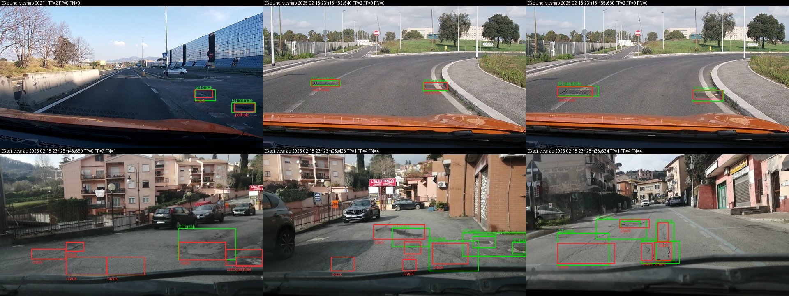
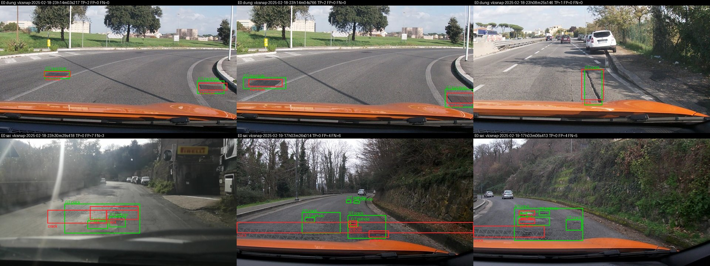

Họ tên: Nguyễn Đức Đông
`dataset_version`: d10-21e4070301

> Toàn bộ số liệu dưới đây lấy từ `report/evidence/*.json` (sinh bởi `scripts/score.py`, split `test`, 311 ảnh) và `work/*/run.json` (thời gian, VRAM). Chạy trên Google Colab **Tesla T4 16 GB**, transformers 5.19.0, peft 0.21.2, bitsandbytes 0.50.2. Mã: `lab/` + `lab_day10.ipynb`.

## Bảng tổng hợp (số của bạn, lấy từ `report/evidence/*.json`)

| Mã | Setup | Tham số huấn luyện | VRAM đỉnh (GB) | Phút | F1 | CI95 | FP/ảnh | F1 pothole | F1 crack | F1 manhole |
|---|---|---|---|---|---|---|---|---|---|---|
| E0 | zero-shot | 0 | – | 0 | 0,095 | 0,066–0,127 | 0,91 | 0,130 | 0,031 | 0,204 |
| E1 | LoRA LLM | 33.030.144 | 6,44 | 44,6 | 0,280 | 0,241–0,320 | 1,27 | 0,168 | 0,215 | 0,541 |
| E2 | + projector | 142.135.296 | 8,14 | 40,8 | 0,335 | 0,298–0,373 | 1,12 | 0,179 | 0,268 | 0,601 |
| E3 | + LoRA ViT | 148.426.752 | 8,31 | 49,0 | **0,431** | 0,390–0,475 | 0,93 | 0,291 | 0,329 | 0,734 |
| E4 | data_size = 0,1 (trên E3) | 148.426.752 | 7,77 | dừng ở bước 120/300 (≈20 phút) | – | – | – | – | – | – |
| E4 | data_size = 1,0 (= E3, `e4_data_size_1.0.json`) | 148.426.752 | 8,31 | 49,0 | 0,431 | 0,390–0,475 | 0,93 | 0,291 | 0,329 | 0,734 |

Thêm: `parse_valid_rate` E0 = 0,923 · E1 = 0,994 · E2 = 0,997 · E3 = 1,000; mean IoU các cặp khớp E0 0,598 · E1 0,677 · E2 0,667 · E3 0,694. Thời gian suy luận 311 ảnh (batch 8, tối đa 256 token): ≈ 11–12 phút mỗi setup. Đường loss: `report/figures/loss_curves.png`.

## 10 câu hỏi (trả lời bằng **số của bạn**, không chép lại tài liệu)

### Câu 1 — Kiến trúc: ViT, projector và LLM của Qwen3-VL-4B có bao nhiêu tham số mỗi khối, và E1/E2/E3 mỗi cái cập nhật khối nào?
Đếm trực tiếp trên model đã nạp (`lab/inspect_setup.py` → `report/setup_check.json`):

| Khối | Tham số | E1 | E2 | E3 |
|---|---|---|---|---|
| ViT (`model.visual.blocks`, 24 block, hidden 1024) | 306.242.560 | đóng băng | đóng băng | **LoRA** r=16 trên `attn.qkv/proj`, `mlp.linear_fc1/fc2` (96 module, 6,29M) |
| Projector (`visual.merger` ≈ 27M + `visual.deepstack_merger_list` ×3 ≈ 82M) | 109.105.152 | đóng băng | **huấn luyện đầy đủ** (fp32) | **huấn luyện đầy đủ** |
| LLM + embedding (36 lớp, hidden 2560; `lm_head` buộc với embedding) | 4.022.468.096 | **LoRA** r=16 trên q/k/v/o + gate/up/down (252 module, 33,03M) | LoRA | LoRA |
| Tổng | 4.437.815.808 | 33.030.144 | 142.135.296 | 148.426.752 |

E2 − E1 = 109.105.152 đúng bằng projector. Ảnh 640×360 được resize về 640×352 → lưới patch 16 px là 22×40 = 880 patch, merger gộp 2×2 → **220 token** ảnh (đã in `image_grid_thw = [1, 22, 40]`).

### Câu 2 — E0: `parse_valid_rate` bằng bao nhiêu, và hai lỗi phổ biến nhất của model gốc là gì (kèm một ví dụ output thô)?
`parse_valid_rate` = **0,923** (24/311 output hỏng). Model gốc không bọc ```json (0 lần), lỗi nằm ở nội dung:

1. **Lặp box đến khi bị cắt → JSON hỏng.** Cả 24 output hỏng đều là một chuỗi box `crack` dịch đều từng bước cho tới khi chạm `max_new_tokens=256`, nên thiếu `]`. Ví dụ thô: `[{"label": "crack", "bbox_2d": [550, 400, 600, 450]}, {"label": "crack", "bbox_2d": [550, 450, 600, 500]}, {"label": "crack", "bbox_2d": [550, 500, 600, 550]}, …` (bị cắt).
2. **Bịa box / box khổng lồ, sai lớp crack.** 31/327 box hợp lệ phủ > 25% khung hình, ví dụ ảnh `vlcsnap-00201`: `[{"label": "crack", "bbox_2d": [0, 476, 1000, 999]}]` (cả nửa dưới mặt đường). Vì vậy precision crack chỉ 0,038 và recall toàn cục 0,074; model biết thang 0–1000 (manhole định vị khá: P = 0,305) nhưng không biết "crack" trong bộ nhãn này là box nhỏ quanh vết nứt.

### Câu 3 — Thang 0–1000: nếu chấm output theo pixel (hoặc ngược lại) thì F1 ra sao và vì sao? Bạn đã kiểm chứng điều này thế nào?
Tôi chấm lại chính output E3 (`work/e3.jsonl`, sinh ra trên thang 0–1000) bằng `evaluate(..., coord="pixel")`: **F1 rơi từ 0,431 xuống 0,000** (`report/analysis.json`). Lý do: khi coi số là pixel, `score.py` quy về thang 0–1000 bằng x·1000/640 và y·1000/360, tức mọi toạ độ x bị nhân 1,5625 và y bị nhân 2,78. Box bị đẩy xuống dưới–sang phải và giãn ra (phần lớn bị kẹp ra ngoài khung); IoU với box đúng gần như luôn < 0,5 nên không còn TP nào, dù JSON vẫn hợp lệ 100%. Chiều ngược lại cũng sụp: test `test_roundtrip_scores_perfect` trong `lab/tests/test_lab.py` tạo nhãn pixel cho một ảnh, chấm bằng `--coord pixel` được F1 = 1,0 nhưng chấm bằng `norm1000` thì F1 = 0,0 (box co về góc trên–trái).

Thang 0–1000 tương đối giúp toạ độ không phụ thuộc độ phân giải: Qwen3-VL resize ảnh động (ở đây 640×360 → 640×352), nên pixel tuyệt đối của ảnh gốc khác pixel model thấy; số trong khoảng cố định 0–1000 cũng là đúng quy ước grounding model đã được tiền huấn luyện, nên E0 đã định vị được manhole mà không cần học lại thang. Tôi kiểm chứng nhãn bằng cách quy ngược 0–1000 → pixel và so với box YOLO gốc (sai số ≤ 0,64 px do làm tròn, notebook mục 2), và vẽ lại box lên ảnh (`report/figures/data_samples.jpg`).

### Câu 4 — Mask loss: vì sao chỉ tính loss trên phần trả lời? Điều gì xảy ra nếu tính trên cả prompt và token ảnh?
Với ví dụ train đầu tiên, chuỗi đầy đủ dài **587 token**, trong đó 220 là `<|image_pad|>`, phần còn lại là template + prompt; chỉ **249 token** (JSON đáp án + `<|im_end|>`) có `labels ≠ -100` — tôi đã giải mã riêng phần này và nó khớp đúng chuỗi đáp án (`report/setup_check.json`, trường `learned_text`). Mục tiêu là học P(đáp án | ảnh, prompt); prompt giống hệt nhau ở mọi ví dụ và token ảnh là placeholder cố định, nên nếu tính loss trên chúng: (a) ~58% token trong loss là thứ hiển nhiên/ không có thông tin, gradient bị pha loãng → học đáp án chậm hơn ở cùng 300 bước; (b) loss trông thấp giả (model nhanh chóng thuộc prompt) nên khó theo dõi; (c) model bị kéo để "sinh" prompt và chuỗi `<|image_pad|>`, có thể làm lệch hành vi sinh (lặp lại chỉ dẫn). Tôi cũng bỏ token `\n` mà template tự thêm sau `<|im_end|>` để model học dừng đúng tại `<|im_end|>`; kết quả E1–E3 có `parse_valid_rate` 0,994–1,000, không còn lỗi lặp đến hết 256 token như E0.

### Câu 5 — Vì sao không thể huấn luyện đầy đủ projector nếu ViT bị lượng tử hoá 4-bit, và bạn đã xử lý thế nào? Vì sao projector phải ở float32?
Lượng tử hoá NF4 thay `nn.Linear` bằng `Linear4bit`: trọng số lưu thành byte `uint8` đóng gói 2 giá trị/byte + hằng số absmax theo khối. Đó không phải tensor số thực khả vi; muốn cập nhật đầy đủ phải giải lượng tử → cộng gradient → lượng tử lại, mỗi bước mất gần hết cập nhật nhỏ (lr 2e-4) vì sai số làm tròn NF4 lớn hơn nhiều. Chỉ có thể gắn LoRA lên trên.

**Tôi gặp đúng lỗi này trên thực tế:** với transformers 5.19, `llm_int8_skip_modules=["visual", "lm_head"]` như trong GUIDE *chỉ* giữ được `lm_head`; `model.visual.merger.linear_fc1` vẫn là `Linear4bit` dtype `uint8` shape `(8388608, 1)` và số "tham số" projector đếm được chỉ còn **54.579.200** (một nửa của 109M, vì 2 giá trị 4-bit/byte). Nếu không để ý, E2 sẽ "huấn luyện" byte đóng gói. Tôi sửa bằng cách liệt kê **tên đầy đủ** của mọi Linear trong ViT và projector (`lab/vlm.py::skip_modules`); sau đó các module này là `Linear` fp16 và projector đủ 109.105.152 tham số.

Projector phải ở **float32** vì: (1) `GradScaler` của AMP từ chối unscale gradient fp16 của tham số; (2) AdamW cập nhật `lr·m/√v` cỡ 1e-5–1e-4 tương đối, nhỏ hơn bước lượng tử của fp16 (≈1e-3 tương đối) nên cộng thẳng vào trọng số fp16 sẽ bị làm tròn mất; (3) trạng thái Adam (v là bình phương gradient) dễ tràn/mất ở fp16. Tính toán forward vẫn chạy trong `autocast(fp16)` nên tốn thêm VRAM chủ yếu cho bản fp32 + 2 trạng thái Adam: 109M × (4+4+4+4) B ≈ 1,7 GB — khớp với chênh lệch VRAM đỉnh E2 − E1 = 8,14 − 6,44 = **1,70 GB**.

### Câu 6 — Split theo phiên quay: vì sao chia ngẫu nhiên sẽ cho F1 cao giả? Số ảnh và số box từng lớp ở mỗi split là bao nhiêu?

| Split | Ảnh | pothole | crack | manhole |
|---|---|---|---|---|
| train | 1.422 | 1.074 | 1.750 | 691 |
| val | 276 | 66 | 470 | 103 |
| test | 311 | 121 | 299 | 163 |

Tôi đã kiểm tra không có `session` nào nằm ở hai split. Ảnh là frame cắt từ video dashcam: hai frame liền nhau gần như trùng (cùng ổ gà, cùng nắp cống, chỉ dịch vài pixel). Chia ngẫu nhiên thì gần như mọi ảnh test có "anh em sinh đôi" trong train; model (đặc biệt LoRA 300 bước × 8 ảnh ≈ 1,7 epoch) chỉ cần nhớ vị trí box của frame bên cạnh là trúng IoU ≥ 0,5, nên F1 đo được là khả năng *ghi nhớ* chứ không phải *tổng quát hoá* sang con đường mới — F1 cao giả. Chia theo phiên buộc test là những đoạn đường model chưa thấy. Cái giá: phân bố lớp lệch (val chỉ 66 pothole, test có tỉ lệ manhole cao hơn train), nên phải đọc F1 từng lớp và CI.

### Câu 7 — So sánh E1/E2/E3: mở projector và LoRA trên ViT có đáng không (F1, CI95, VRAM, thời gian)?
- **E1 → E2 (+projector 109M):** F1 0,280 → 0,335 (+0,055), crack +0,053, manhole +0,060, FP/ảnh 1,27 → 1,12. VRAM +1,70 GB; thời gian không tăng (40,8 so với 44,6 phút — chênh do biến động của máy Colab, không phải do E2 nhẹ hơn). Nhưng CI95 chồng lấn (0,241–0,320 vs 0,298–0,373) nên chưa chắc chắn.
- **E2 → E3 (+LoRA ViT 6,3M):** F1 0,335 → **0,431** (+0,096), cải thiện cả ba lớp (pothole 0,179 → 0,291, crack 0,268 → 0,329, manhole 0,601 → 0,734), FP/ảnh giảm còn 0,93, mean IoU 0,694. Giá chỉ +0,17 GB VRAM và +8 phút (49,0 so với 40,8) vì gradient phải chảy qua 24 block ViT. CI95 của E3 (0,390–0,475) **không chồng** lên E2 hay E1.

Kết luận: **E3 đáng đồng tiền nhất** — thêm 4% tham số so với E2 mà F1 tăng ~29%; bài toán cần ViT thích nghi vì đối tượng là vết nứt/ổ gà nhỏ (box trung vị ≈ 0,7% khung hình) mà đặc trưng ViT tiền huấn luyện không tách tốt. Mở projector có lợi nhưng nhỏ so với nhiễu thống kê. Tất cả vẫn vừa T4 (≤ 8,31 GB).

### Câu 8 — Tập test có 311 ảnh: khoảng tin cậy rộng thế nào, và điều đó giới hạn kết luận so sánh các setup ra sao?
CI95 bootstrap theo ảnh (1.000 lần) rộng khoảng **±0,04 F1** (E1: 0,079; E2: 0,075; E3: 0,085; E0: 0,061). Vì thế:
- E1 vs E2 (Δ = 0,055) chồng lấn CI → chưa đủ bằng chứng nói mở projector giúp; chạy lại với seed khác có thể đảo thứ tự.
- E3 vs E2 (Δ = 0,096) và mọi setup vs E0 nằm ngoài CI → kết luận đứng vững.
- F1 từng lớp còn kém tin cậy hơn: test chỉ có 121 pothole; F1 pothole thay đổi 0,168 → 0,291 nhưng mỗi box đúng/sai làm F1 lớp này nhích ~0,008.
- CI bootstrap theo ảnh còn **hẹp hơn thực tế** vì các ảnh trong cùng phiên tương quan mạnh (số "mẫu độc lập" thật nhỏ hơn 311); bootstrap theo phiên sẽ cho CI rộng hơn. Chỉ một seed cho mỗi setup, nên khác biệt < ~0,05 không nên được báo là cải thiện.

### Câu 9 — Phân tích lỗi theo lớp: lớp nào kém nhất và vì sao (kích thước box, số mẫu, ngữ nghĩa)? Kèm ảnh minh hoạ.
Đếm TP/FP/FN của E3 theo lớp (`report/analysis.json`) và diện tích box trung vị (% khung hình):

| Lớp | Box test | TP | FP | FN | P | R | F1 E3 | Diện tích trung vị (train / test) |
|---|---|---|---|---|---|---|---|---|
| pothole | 121 | 30 | 55 | 91 | 0,353 | 0,248 | **0,291** | 0,38% / 0,42% |
| crack | 299 | 100 | 208 | 199 | 0,325 | 0,334 | 0,329 | 1,35% / 1,98% |
| manhole | 163 | 109 | 25 | 54 | 0,813 | 0,669 | 0,734 | 0,39% / 0,67% |

- **Pothole kém nhất** (F1 0,291, recall chỉ 0,248): box nhỏ nhất (trung vị 0,42% khung ≈ 970 px², cỡ 30×30 px — xấp xỉ **một** token ảnh, vì mỗi token sau merger phủ 32×32 px), và về ngữ nghĩa dễ lẫn với bóng cây, vết vá, vũng nước; model bỏ sót phần lớn ổ gà ở xa. Dù train có 1.074 pothole (nhiều hơn manhole), ít mẫu không phải nguyên nhân chính — kích thước và độ mơ hồ mới là.
- **Crack nhiều FP nhất** (208): "crack" là đối tượng dài, mảnh, không có ranh giới tự nhiên. Ảnh `e3_sai_vlcsnap-2025-02-18-23h25m48s850.jpg`: nhãn chỉ có **1** box crack, model trả **6** box crack nối nhau + 1 pothole → 7 FP, 1 FN dù đều nằm đúng trên vết nứt. Lỗi ở đây là cách chia box không khớp với người gán nhãn hơn là "không thấy" vết nứt.
- **Manhole tốt nhất** (P 0,813): hình tròn/vuông, có viền kim loại rõ, ít biến thể — E0 đã định vị được (P 0,305) và LoRA ViT đẩy lên 0,734.
- Lẫn lớp: `e3_sai_vlcsnap-2025-02-18-23h26m05s423.jpg` (GT 2 manhole + 3 crack, model trả 5 crack) và `e3_sai_vlcsnap-2025-02-18-23h28m38s634.jpg` (pothole bị gọi thành crack).

Ảnh minh hoạ (box **xanh lá = nhãn đúng**, **đỏ = dự đoán**, tiêu đề ghi TP/FP/FN): `report/figures/e3_gallery.jpg` (3 ảnh đúng + 3 ảnh sai của E3) và `report/figures/e0_gallery.jpg` (E0: 3 đúng + 3 sai, ví dụ `e0_sai_vlcsnap-2025-02-18-23h30m29s418.jpg` trả 7 box crack, 0 TP). Ảnh lẻ có chú thích chi tiết trong `report/figures/*_captions.json`.




### Câu 10 — E4: bạn đổi biến nào, kết quả thế nào, và kết luận có đáng tin không?
Biến chọn: **`data_size`** (tỉ lệ ảnh train), trên setup tốt nhất **E3**, giữ nguyên mọi thứ khác (r=16, lr 2e-4, 300 bước, batch 2×4, seed 42). Hai giá trị: 1,0 (chính là E3, đã chấm lại thành `report/evidence/e4_data_size_1.0.json`: F1 0,431, CI95 0,390–0,475) và 0,1 (142 ảnh, chọn ngẫu nhiên với seed 42).

**Kết quả thật:** lần chạy 0,1 bị **dừng ở bước 120/300** (≈ 20 phút, VRAM đỉnh 7,77 GB) vì hết thời gian làm bài, nên **chưa có F1 test cho data_size = 0,1** — tôi không báo con số nào cho nó. Dấu hiệu duy nhất đo được: loss train ở bước 110–120 là 0,35–0,41, thấp hơn rõ so với E3 đầy đủ ở cùng bước (≈ 0,58–0,61). Với 142 ảnh, 120 bước × 8 ảnh ≈ 6,8 epoch nên model đang thuộc lòng tập train nhỏ (quá khớp), đúng như dự đoán; nhưng loss train thấp không nói gì về F1 test.

**Độ tin cậy:** chưa kết luận được. Để kết luận cần chạy hết 300 bước và chấm test; ngay cả khi đó, CI95 rộng ±0,04 nghĩa là chỉ khác biệt > ~0,08 F1 mới đáng tin. Tôi kỳ vọng 10% dữ liệu sẽ giảm F1 rõ rệt (nhiều hơn 0,08) vì 142 ảnh bao phủ ít đoạn đường hơn nhiều, nhưng đây là giả thuyết, chưa được đo.

## Nhìn lại

- **Lỗi công cụ mà bộ chấm không bắt được:** `llm_int8_skip_modules=["visual","lm_head"]` theo GUIDE không còn đúng với transformers 5.19 — ViT/projector âm thầm bị lượng tử hoá 4-bit; không có cảnh báo nào, chỉ lộ ra khi tôi đếm tham số projector (54,6M thay vì 109M) và in kiểu module. `check_submission.py` không kiểm tra điều này, nên một bài nộp có thể có E2/E3 "huấn luyện" byte đóng gói mà vẫn qua mọi kiểm tra.
- **Môi trường Colab:** torchao 0.10 cài sẵn khiến peft 0.21 ném `ImportError` khi gắn LoRA vào `nn.Linear` fp16 của ViT (E3); phải `pip uninstall torchao`. Session Colab miễn phí bị ngắt một lần giữa chừng; nhờ lưu `work/` lên Drive (adapter + `projector.pt` mỗi 100 bước) và suy luận có thể chạy tiếp (bỏ qua ảnh đã có), tôi không phải train lại E1.
- **Điều chưa chắc:** khác biệt E1/E2 nằm trong nhiễu; tôi chỉ chạy một seed. Loss huấn luyện cuối của E1/E2/E3 (≈0,60/0,52/0,51) chênh ít hơn nhiều so với F1 test → loss token-level không phản ánh tốt chất lượng định vị (một chữ số toạ độ sai vài đơn vị đã đủ làm IoU < 0,5).
- **Dữ liệu:** tên lớp "crack" phủ cả vết nứt dài mảnh lẫn mảng nứt da cá; box của cùng một loại vết nứt được vẽ rất khác nhau giữa các ảnh, nên trần F1 của crack có lẽ thấp hơn các lớp khác ngay cả với người.
- **E5 (GRPO):** chỉ viết hàm reward IoU và test (`lab/reward.py`, `lab/tests/test_lab.py`: hoàn hảo, JSON hỏng, sai lớp, thừa box, rỗng, box khổng lồ); chưa chạy GRPO vì hết thời gian GPU.
- **E4 chưa hoàn tất:** lần chạy `data_size = 0,1` bị dừng ở bước 120/300, nên E4 hiện chỉ có giá trị 1,0 được chấm. Chạy lại: `python -m lab.run train --exp e3 --out work/e4_data_size_0.1 --train-fraction 0.1` rồi `infer` + `score` (notebook mục 8).
